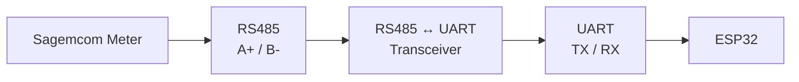
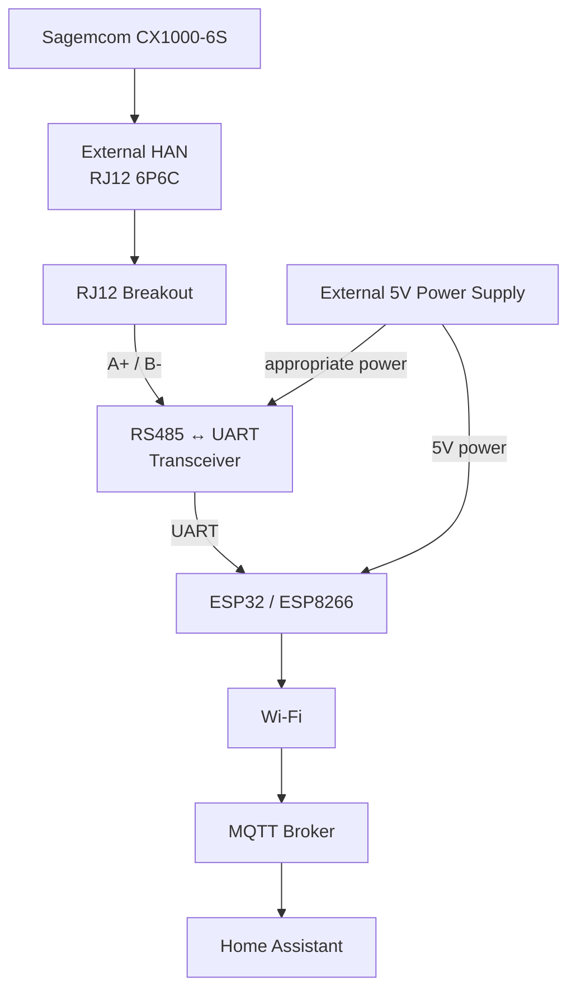
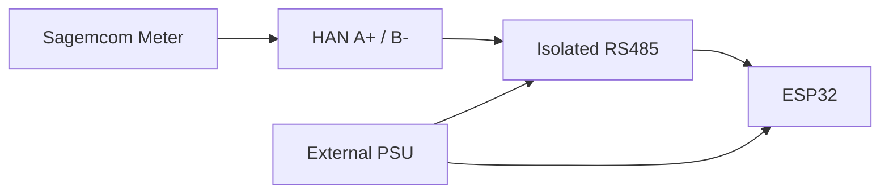
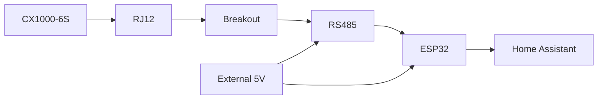

# Sagemcom CX1000-6S → Home Assistant via HAN / RJ12 / RS485

> **Beginner-friendly guide**
>
> This document describes a possible way to connect a **Sagemcom CX1000-6S electricity meter** to **Home Assistant** using the meter's **HAN (Home Area Network)** interface, an **RJ12 connection**, an **RS485 transceiver**, and an **ESP32/ESP8266**.

---

# 1. Overview

The overall system is:


The important thing to understand is that there are **three different things happening**:

1. The **HAN/RJ12 connection** provides access to the meter's data.
2. The **RS485 transceiver** converts the meter's RS485 electrical signals into UART signals.
3. The **ESP32/ESP8266** reads the UART data and sends it to Home Assistant over Wi-Fi.

The ESP does **not** connect directly to the meter's RS485 A/B wires.

---

# 2. Important safety warning

## Do not open the electricity meter

The Sagemcom CX1000-6S is part of the electrical installation and should not be opened by the user.

Do **not**:

* Remove the meter's seals.
* Open the meter enclosure.
* Connect anything to the mains terminals.
* Modify the internal wiring.
* Attempt to access the internal HAN connector yourself.

The project documentation describes requesting external HAN access from **E-REDES**, with the connection made available externally. ([GitHub project](https://github.com/tiagofreire-pt/Home_Assistant_EDP_Box))

The recommended approach is therefore:


---

# 3. The HAN connection

The HAN interface may not be visible as an RJ12 socket on the front of the meter.

The GitHub project documents an **external RJ12 6P6C connection** that can be provided for the HAN interface.

The relevant project is:

[Home_Assistant_EDP_Box — GitHub](https://github.com/tiagofreire-pt/Home_Assistant_EDP_Box)

The project documentation also describes requesting the external HAN connection from E-REDES.

[E-REDES — HAN / serial communication access](https://www.e-redes.pt/pt-pt/redes-do-futuro-redes-inteligentes/servicos-redes-inteligentes/acesso-porta-serie-de-comunicacao)

---

# 4. RJ12 pinout

The project documents the HAN connection as an **RJ12 6P6C** interface.

The documented pinout is:

| RJ12 pin | Signal | Function              |
| -------: | ------ | --------------------- |
|        1 | GND    | Ground                |
|        2 | A+     | Duplicated connection |
|        3 | B-     | RS485 B               |
|        4 | B-     | Duplicated connection |
|        5 | A+     | RS485 A               |
|        6 | +5 V   | HAN power             |

The project documents pins 3 and 5 as the main RS485 connections and pins 2 and 4 as duplicated connections. ([GitHub project README](https://github.com/tiagofreire-pt/Home_Assistant_EDP_Box/blob/master/EDP%20Box/README.md))

For this build, the important connections are therefore:

```text
RJ12 pin 1  → GND
RJ12 pin 3  → RS485 B
RJ12 pin 5  → RS485 A
RJ12 pin 6  → +5 V (NOT USED FOR POWER in recommended design)
```

---

# 5. RJ12 breakout board

A breakout board makes the RJ12 connection much easier to work with.

One suitable example is:

[PMD Way — RJ11/RJ12 6P6C 2-Way Bus Breakout Board](https://pmdway.com/collections/rj11-rj12-breakout/products/rj11-rj12-6p6c-2-way-buss-breakout-board)

Instead of cutting the RJ12 cable, the cable plugs directly into the breakout board and the individual pins become available on screw terminals.

Conceptually:

```text
                RJ12 cable
                    │
                    ▼
        ┌──────────────────────┐
        │    RJ12 BREAKOUT     │
        │                      │
        │  1 ─── GND           │
        │  2 ─── A+            │
        │  3 ─── B-            │
        │  4 ─── B-            │
        │  5 ─── A+            │
        │  6 ─── +5V           │
        │                      │
        └──────────────────────┘
```

---

# 6. Why an RS485 transceiver is required

The ESP32 has UART interfaces:

```text
TX
RX
```

The meter provides an RS485 differential interface:

```text
A+
B-
```

These are **not electrically compatible**.

Therefore, an RS485 transceiver is required between the meter and the ESP.



The transceiver performs the electrical conversion.

---

# 7. Complete hardware architecture

The recommended hardware arrangement is:



The most important design decision here is:

> **Do not rely on the HAN's +5 V output to power the ESP.**

Instead, use a separate 5 V power supply for the ESP and, if necessary, the RS485 transceiver.

---

# 8. HAN power limitation

The HAN interface provides a +5 V output.

According to the project documentation, the available HAN supply is limited to approximately:

**150 mA**

This is an important limitation.

It might be tempting to do this:

```text
             HAN +5V
                │
                │
        ┌───────┴───────┐
        │               │
       ESP          RS485 module
```

In other words:

```text
HAN +5V
   │
   ├── ESP
   │
   └── RS485 module
```

The problem is that the ESP's Wi-Fi radio can create short current spikes.

The ESP may consume relatively little current most of the time, but its instantaneous current demand can increase significantly when Wi-Fi is active.

The RS485 module also consumes power.

Therefore, the combined load could approach or exceed the HAN's **150 mA limit**.

That can potentially cause:

* ESP resets
* Unstable operation
* Communication errors
* HAN power supply overload
* Unpredictable behaviour

The project documentation consequently recommends using **external power**. ([GitHub project README](https://github.com/tiagofreire-pt/Home_Assistant_EDP_Box/blob/master/EDP%20Box/README.md))

---

# 9. Recommended power architecture

The safer design is to **leave the HAN +5 V disconnected** and power the electronics from an independent 5 V supply.

### Recommended arrangement

```text
                         Sagemcom CX1000-6S
                                  │
                                  │
                              HAN RJ12
                                  │
                                  ▼
                       ┌──────────────────┐
                       │  RJ12 BREAKOUT   │
                       │                  │
                       │ Pin 1 ── GND ────┼─────────────┐
                       │                  │             │
                       │ Pin 3 ── B- ─────┼──────┐      │
                       │                  │      │      │
                       │ Pin 5 ── A+ ─────┼───┐  │      │
                       │                  │   │  │      │
                       │ Pin 6 ── +5V ────┼───┼──┼── NC │
                       │                  │   │  │      │
                       └──────────────────┘   │  │      │
                                              │  │      │
                                              ▼  ▼      │
                                         ┌──────────────┐
                                         │    RS485     │
                                         │ Transceiver  │
                                         │              │
                                         │ A ◄──────────┤
                                         │ B ◄──────────┤
                                         │ GND ◄────────┤
                                         └──────┬───────┘
                                                │
                                               UART
                                                │
                                                ▼
                                         ┌──────────────┐
                                         │    ESP32      │
                                         │              │
                                         │  Wi-Fi       │
                                         └──────┬───────┘
                                                │
                                                │
                                   External 5V  │
                                     Power      │
                                     Supply     │
                                         │      │
                                         └──────┘
```

### In simple terms

The meter provides:

```text
Pin 1 → GND
Pin 3 → RS485 B
Pin 5 → RS485 A
Pin 6 → +5 V
```

But in the recommended design:

```text
Pin 1 → used as signal ground/reference
Pin 3 → RS485 B
Pin 5 → RS485 A
Pin 6 → NOT CONNECTED
```

The ESP gets its power from:

```text
External 5 V power supply
          │
          ▼
        ESP32
```

The RS485 transceiver gets its power from the appropriate external supply as well.

---

# 10. Power wiring — simplified

This is the most important diagram to understand:

```text
                     Sagemcom CX1000-6S
                             │
                           RJ12
                             │
                             ▼
                  ┌─────────────────────┐
                  │    RJ12 BREAKOUT    │
                  │                     │
                  │ Pin 1  GND ─────────┼───────────┐
                  │                     │           │
                  │ Pin 3  B- ──────────┼─────┐     │
                  │                     │     │     │
                  │ Pin 5  A+ ──────────┼──┐  │     │
                  │                     │  │  │     │
                  │ Pin 6  +5V ─────────┼──┼──┼── X  │
                  │                     │  │  │  NOT │
                  └─────────────────────┘  │  │ USED │
                                           │  │      │
                                           ▼  ▼      │
                                      ┌───────────────┴───┐
                                      │  RS485 MODULE    │
                                      │                  │
                                      │ A ◄──────── A+   │
                                      │ B ◄──────── B-   │
                                      │ GND ◄────── GND  │
                                      └─────────┬────────┘
                                                │
                                                │ UART
                                                ▼
                                         ┌─────────────┐
                                         │    ESP32    │
                                         │             │
                                         │  TX / RX    │
                                         └──────┬──────┘
                                                ▲
                                                │
                                      ┌─────────┴────────┐
                                      │  EXTERNAL 5V PSU │
                                      └──────────────────┘
```

**The `X` on RJ12 pin 6 means: leave it disconnected.**

This is the key difference between the two approaches.

---

# 11. What happens to the HAN +5 V?

Nothing.

It simply remains unused.

```text
RJ12 pin 6
   │
   X
   │
  NC
```

`NC` means:

> **Not Connected**

There is no need to connect the HAN +5 V to the ESP if an external power supply is being used.

This avoids unnecessarily loading the meter's limited 150 mA HAN power supply.

---

# 12. What about GND?

The HAN GND is:

```text
RJ12 pin 1
```

This can be used as the electrical reference for the RS485 interface, depending on the selected transceiver and wiring arrangement.

Conceptually:

```text
HAN pin 1
   │
   └──────────────► RS485 GND / signal reference
```

The external power supply provides power to the electronics.

A key distinction is:

> **GND is a signal reference; it is not the same thing as using the HAN +5 V to power the ESP.**

So the recommended design is:

```text
HAN:
    GND ───────► signal/reference
    A+  ───────► RS485 A
    B-  ───────► RS485 B
    +5V ───────► unused

External PSU:
    +5V ───────► ESP / RS485 electronics
    GND ───────► electronics GND
```

Whether the external PSU ground should be tied directly to the HAN ground depends on the **exact RS485 transceiver** being used.

This is particularly important if an **isolated RS485 transceiver** is selected.

---

# 13. Non-isolated RS485 module

With a normal non-isolated RS485 transceiver, the conceptual arrangement is:

```text
                     HAN
                      │
       ┌──────────────┼──────────────┐
       │              │              │
      A+             B-             GND
       │              │              │
       ▼              ▼              ▼
   RS485 A        RS485 B        Reference
       │              │              │
       └──────┬───────┴──────┬───────┘
              │              │
              ▼              ▼
         RS485 transceiver
              │
              │ UART
              ▼
             ESP32
              ▲
              │
         External 5V
```

The exact grounding arrangement must follow the transceiver's datasheet.

---

# 14. Isolated RS485 option

For a more robust design, an **isolated RS485 transceiver** can be considered.

The concept is:



The isolation barrier separates the meter-side RS485 interface from the ESP-side electronics.

This is not necessarily required for the project, but it is a design option worth considering.

---

# 15. Complete connection diagram

Assuming a **non-isolated RS485 transceiver** and an external power supply:

```text
                     Sagemcom CX1000-6S
                             │
                             │
                          HAN RJ12
                             │
                             ▼
                  ┌─────────────────────┐
                  │    RJ12 BREAKOUT    │
                  │                     │
                  │ Pin 1 ── GND ───────┼───────────────┐
                  │                     │               │
                  │ Pin 2 ── A+ ────────┼── NC           │
                  │                     │               │
                  │ Pin 3 ── B- ────────┼───────────┐   │
                  │                     │           │   │
                  │ Pin 4 ── B- ────────┼── NC      │   │
                  │                     │           │   │
                  │ Pin 5 ── A+ ────────┼────────┐  │   │
                  │                     │        │  │   │
                  │ Pin 6 ── +5V ───────┼── NC   │  │   │
                  │                     │        │  │   │
                  └─────────────────────┘        │  │   │
                                                 │  │   │
                                                 ▼  ▼   ▼
                                           ┌─────────────────┐
                                           │ RS485 TRANSCEIVER│
                                           │                 │
                                           │ A ◄─────────────┤
                                           │ B ◄─────────────┤
                                           │ GND ◄───────────┤
                                           │                 │
                                           │ RO ────────► RX │
                                           │ DI ◄──────── TX │
                                           │ DE ◄────── GPIO │
                                           │ RE ◄────── GPIO │
                                           └────────┬────────┘
                                                    │
                                                    │ UART
                                                    ▼
                                             ┌────────────┐
                                             │   ESP32    │
                                             │            │
                                             │ TX / RX    │
                                             │ Wi-Fi      │
                                             └─────┬──────┘
                                                   │
                                                   │ Wi-Fi
                                                   ▼
                                             ┌────────────┐
                                             │    MQTT    │
                                             └─────┬──────┘
                                                   │
                                                   ▼
                                          ┌──────────────────┐
                                          │ Home Assistant   │
                                          └──────────────────┘


       EXTERNAL POWER
       ──────────────

       External 5V PSU
             │
             ├──────────────► ESP32 power
             │
             └──────────────► RS485 module power
```

---

# 16. Important note about the power supply

The exact wiring of the external power supply depends on the chosen ESP board and RS485 transceiver.

For example, an ESP32 development board may have:

```text
USB 5V
   ↓
on-board voltage regulator
   ↓
3.3V ESP electronics
```

Therefore, the 5 V supply can often be connected to the board's USB connector or appropriate 5 V/VIN input.

But **do not assume that every ESP board has the same power input arrangement**.

Likewise, do not assume that every RS485 module accepts 5 V.

Before wiring:

1. Identify the exact ESP board.
2. Identify the exact RS485 module.
3. Check their voltage requirements.
4. Check their logic-level compatibility.
5. Only then connect the power.

---

# 17. Why not use the HAN 5 V if it is available?

Because the HAN power is a limited resource.

The meter provides approximately:

```text
+5 V
maximum ≈ 150 mA
```

Using it would mean the meter is responsible for powering:

```text
ESP
+
Wi-Fi activity
+
RS485 transceiver
```

Instead, the recommended design is:

```text
                 HAN
                  │
        ┌─────────┴─────────┐
        │                   │
     DATA ONLY          GND/reference
        │                   │
        ▼                   ▼
     RS485              Electronics
        │
        ▼
      ESP32
        ▲
        │
   External PSU
```

This keeps the ESP's potentially variable power consumption away from the meter's limited HAN supply.

---

# 18. RS485 connection

The main RS485 connections are:

```text
RJ12 pin 5 (A+) ───────────► RS485 A
RJ12 pin 3 (B-) ───────────► RS485 B
RJ12 pin 1 (GND) ──────────► RS485 reference/GND
```

The project documents pins 2 and 4 as duplicated connections, so they should not be treated as additional independent RS485 signals. ([GitHub project README](https://github.com/tiagofreire-pt/Home_Assistant_EDP_Box/blob/master/EDP%20Box/README.md))

---

# 19. RS485 → ESP connection

The RS485 transceiver then connects to the ESP using UART.

A typical arrangement is:

| RS485 transceiver | ESP32                       |
| ----------------- | --------------------------- |
| RO                | RX                          |
| DI                | TX                          |
| DE                | GPIO                        |
| RE                | GPIO                        |
| GND               | GND/reference               |
| VCC               | Appropriate external supply |
| A                 | HAN A+                      |
| B                 | HAN B-                      |

The exact GPIO numbers should be selected after choosing the ESP board and firmware.

---

# 20. RS485 direction control

RS485 transceivers commonly have:

```text
RO
DI
DE
RE
```

These stand for:

* **RO** — Receiver Output
* **DI** — Driver Input
* **DE** — Driver Enable
* **RE** — Receiver Enable

The ESP uses these signals to control whether the transceiver is transmitting or receiving.

A simplified diagram:

```text
                    ESP32
              ┌───────────────┐
              │               │
       RX ◄───┤ UART          │
       TX ───►│ UART          │
              │               │
 GPIO ───────►│ DE            │
 GPIO ───────►│ RE            │
              └───────┬───────┘
                      │
                      ▼
              ┌───────────────┐
              │ RS485         │
              │ Transceiver   │
              └───────────────┘
```

Some RS485 modules combine DE and RE or control them automatically.

Therefore, the exact wiring depends on the module.

---

# 21. RS485 termination

The GitHub project discusses a possible **120 Ω termination resistor** across the RS485 A/B lines.

Conceptually:

```text
RS485 A ────────────────────────┐
                               │
                              [120Ω]
                               │
RS485 B ────────────────────────┘
```

However, do **not** automatically add a 120 Ω resistor just because it is an RS485 system.

Termination depends on:

* Cable length
* Bus topology
* Existing termination
* Location of the RS485 devices
* Characteristics of the HAN installation

For this project, follow the repository's documented configuration and avoid adding multiple termination resistors without understanding where the bus ends.

---

# 22. Software architecture

Once the physical connection works, the software path is:


The ESP reads the meter's serial data and publishes information through MQTT.

Home Assistant can then consume those MQTT values.

---

# 23. Potential Home Assistant data

Depending on the meter protocol and firmware, the system may expose values such as:

* Instantaneous power
* Total imported energy
* Exported energy
* Voltage
* Current
* Tariff/register information
* Other meter registers

The exact values available depend on the meter's configuration and protocol.

Do not assume that every CX1000-6S installation exposes exactly the same registers.

---

# 24. Compatibility warning

The GitHub project is a community project / proof of concept and is **not an official Sagemcom or Home Assistant integration**.

The project's experimental validation lists several meter models, including:

* Janz C3801
* Sagemcom CX2000-9
* LANDIS+GYR ZCXe110CR
* KAIFA MA109P
* ZIV 5CTME2C

The **CX1000-6S is not listed among the models explicitly validated by that project**. ([GitHub project README](https://github.com/tiagofreire-pt/Home_Assistant_EDP_Box/blob/master/EDP%20Box/README.md))

Therefore:

> The RJ12/HAN/RS485 architecture is documented, but successful operation with a particular CX1000-6S should be considered something to verify experimentally.

---

# 25. What is confirmed

According to the project documentation:

* RJ12 6P6C is used for the external HAN connection.
* Pin 1 is GND.
* Pin 3 is B-.
* Pin 5 is A+.
* Pin 6 provides +5 V.
* HAN power is limited to approximately 150 mA.
* RS485 is used for communication.
* External power is recommended.
* E-REDES access needs to be requested.
* A 120 Ω termination may be relevant depending on the installation. ([GitHub project README](https://github.com/tiagofreire-pt/Home_Assistant_EDP_Box/blob/master/EDP%20Box/README.md))

---

# 26. What still needs to be verified

Before building the final system, verify:

* [ ] Your exact meter is a Sagemcom CX1000-6S.
* [ ] E-REDES provides external HAN access.
* [ ] The external connection is RJ12 6P6C.
* [ ] The exact HAN pinout matches the project documentation.
* [ ] The CX1000-6S provides the expected RS485 protocol.
* [ ] The correct baud rate is known.
* [ ] The correct serial parameters are known.
* [ ] The desired meter registers are available.
* [ ] The selected RS485 transceiver is electrically compatible with the ESP.
* [ ] The ESP is powered from an external supply.
* [ ] The HAN +5 V is left disconnected unless there is a specific reason to use it.
* [ ] The termination arrangement is understood before adding a resistor.

---

# 27. Recommended hardware

For a first prototype:

### Required

* Sagemcom CX1000-6S
* E-REDES external HAN/RJ12 connection
* RJ12 6P6C breakout board
* ESP32 development board
* 3.3 V-compatible RS485 transceiver
* External 5 V USB power supply
* Jumper wires / suitable cables
* Enclosure

### Optional

* Isolated RS485 transceiver
* 120 Ω resistor
* Multimeter
* Logic analyser
* USB cable for ESP programming

---

# 28. Recommended build order

Do not build everything at once.

A good beginner-friendly sequence is:

## Step 1 — Confirm the meter

Verify the label:

```text
Sagemcom CX1000-6S
```

Do not open the meter.

---

## Step 2 — Request HAN access

Request external HAN access from E-REDES.

[E-REDES — HAN access information](https://www.e-redes.pt/pt-pt/redes-do-futuro-redes-inteligentes/servicos-redes-inteligentes/acesso-porta-serie-de-comunicacao)

[E-REDES Balcão Digital — HAN request](https://balcaodigital.e-redes.pt/requests/counter-han)

---

## Step 3 — Obtain the RJ12 breakout

Use an RJ12 6P6C breakout board such as:

[PMD Way — RJ11/RJ12 6P6C 2-Way Bus Breakout Board](https://pmdway.com/collections/rj11-rj12-breakout/products/rj11-rj12-6p6c-2-way-buss-breakout-board)

---

## Step 4 — Identify the connections

Start with:

```text
RJ12 pin 1 → GND
RJ12 pin 3 → B-
RJ12 pin 5 → A+
RJ12 pin 6 → leave disconnected
```

---

## Step 5 — Connect the RS485 transceiver

```text
RJ12 pin 5 → RS485 A
RJ12 pin 3 → RS485 B
RJ12 pin 1 → RS485 reference/GND
```

---

## Step 6 — Connect the ESP

Connect the transceiver's UART to the ESP:

```text
RS485 RO → ESP RX
RS485 DI → ESP TX
RS485 DE → ESP GPIO
RS485 RE → ESP GPIO
```

Use the GPIO numbers appropriate for the selected ESP board and firmware.

---

## Step 7 — Power the electronics externally

Use:

```text
External 5V PSU
       │
       ├──────► ESP32
       │
       └──────► RS485 transceiver
```

Do **not** use:

```text
HAN pin 6 (+5V)
       │
       ├──────► ESP32
       └──────► RS485
```

unless the complete power consumption has been measured and confirmed to remain safely below the HAN's 150 mA limit.

---

# 29. Final wiring diagram

The complete recommended design can be summarized as:

```text
                         Sagemcom CX1000-6S
                                  │
                                  │
                              HAN / RJ12
                                  │
                                  ▼
                       ┌──────────────────┐
                       │   RJ12 BREAKOUT  │
                       │                  │
                       │ Pin 1 GND ───────┼───────────────┐
                       │                  │               │
                       │ Pin 3 B- ────────┼──────────┐    │
                       │                  │          │    │
                       │ Pin 5 A+ ────────┼───────┐  │    │
                       │                  │       │  │    │
                       │ Pin 6 +5V ───────┼── X   │  │    │
                       │                  │  NC   │  │    │
                       └──────────────────┘       │  │    │
                                                  │  │    │
                                                  ▼  ▼    ▼
                                            ┌─────────────────┐
                                            │ RS485           │
                                            │ TRANSCEIVER     │
                                            │                 │
                                            │ A ◄──── A+      │
                                            │ B ◄──── B-      │
                                            │ GND ◄── GND     │
                                            │                 │
                                            │ RO ───────► RX  │
                                            │ DI ◄────── TX   │
                                            │ DE ◄──── GPIO   │
                                            │ RE ◄──── GPIO   │
                                            └────────┬────────┘
                                                     │
                                                     │ UART
                                                     ▼
                                              ┌─────────────┐
                                              │    ESP32    │
                                              │             │
                                              │ UART + Wi-Fi│
                                              └──────┬──────┘
                                                     │
                                                     │ Wi-Fi
                                                     ▼
                                              ┌─────────────┐
                                              │ MQTT Broker │
                                              └──────┬──────┘
                                                     │
                                                     ▼
                                           ┌──────────────────┐
                                           │  Home Assistant  │
                                           └──────────────────┘


             EXTERNAL POWER SUPPLY
             ─────────────────────

                   External 5V
                       │
                 ┌─────┴─────┐
                 │           │
                 ▼           ▼
              ESP32      RS485 module
```

### The key point

The system deliberately has **two separate paths**:

```text
             COMMUNICATION PATH
             
CX1000-6S
    │
  RJ12
    │
    ├── A+ ──► RS485
    ├── B- ──► RS485
    └── GND ─► reference
                │
                ▼
              ESP32
```

and:

```text
             POWER PATH

External 5V PSU
       │
       ├────────► ESP32
       │
       └────────► RS485 electronics
```

The HAN's:

```text
Pin 6 = +5V
```

is **not used in the recommended design**.

This prevents the ESP's Wi-Fi current consumption from being added to the HAN's limited **150 mA power budget**.

---

# 30. References

* [Home_Assistant_EDP_Box — GitHub](https://github.com/tiagofreire-pt/Home_Assistant_EDP_Box)
* [Project README — HAN / RJ12 / RS485 information](https://github.com/tiagofreire-pt/Home_Assistant_EDP_Box/blob/master/EDP%20Box/README.md)
* [E-REDES — Access to serial/HAN communication port](https://www.e-redes.pt/pt-pt/redes-do-futuro-redes-inteligentes/servicos-redes-inteligentes/acesso-porta-serie-de-comunicacao)
* [E-REDES Balcão Digital — HAN request](https://balcaodigital.e-redes.pt/requests/counter-han)
* [PMD Way — RJ12 6P6C Breakout Board](https://pmdway.com/collections/rj11-rj12-breakout/products/rj11-rj12-6p6c-2-way-buss-breakout-board)

---

# 31. Short version

If all of the above seems complicated, the project can be reduced to this:



### RJ12

```text
Pin 1 → GND / reference
Pin 3 → RS485 B
Pin 5 → RS485 A
Pin 6 → +5V → NOT USED
```

### Power

```text
External 5V → ESP32
External 5V → RS485 module
```

### Data

```text
CX1000-6S
    ↓
RJ12
    ↓
RS485
    ↓
ESP32
    ↓
Wi-Fi
    ↓
MQTT
    ↓
Home Assistant
```

That is the architecture to aim for.

