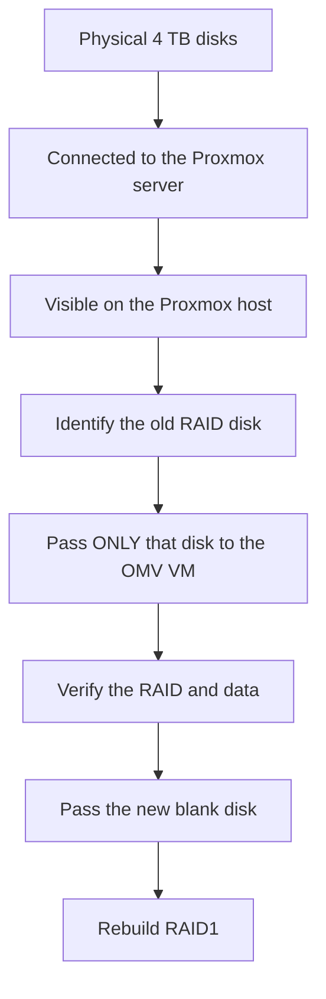

# Info
- hostname: `openmediavault`
- domain: `home.arpa`
- IP: `http://192.168.1.107:80`

Used the root account that i already had. 

# Seting the admin account
This is to access the OMV via the web UI ("Workbench").

```bash
omv-firstaid
```
And restored the admin password.

# Installing QEMU-Guest-Agent

```bash
apt update
apt install qemu-guest-agent
systemctl enable --now qemu-guest-agent
```

But failed to enable the service.

```bash
qemu-guest-agent.service
* └─dev-virtio\x2dports-org.qemu.guest_agent.0.device
● system.slice
● sysinit.target
●   ├─blk-availability.service
●   ├─dev-hugepages.mount
●   ├─dev-mqueue.mount
●   ├─keyboard-setup.service
●   ├─kmod-static-nodes.service
*   ├─ldconfig.service
●   ├─lvm2-lvmpolld.socket
●   ├─lvm2-monitor.service
●   ├─proc-sys-fs-binfmt_misc.automount
●   ├─sys-fs-fuse-connections.mount
●   ├─sys-kernel-config.mount
●   ├─sys-kernel-debug.mount
●   ├─sys-kernel-tracing.mount
●   ├─systemd-ask-password-console.path
●   ├─systemd-binfmt.service
*   ├─systemd-firstboot.service
*   ├─systemd-hibernate-clear.service
*   ├─systemd-hwdb-update.service
●   ├─systemd-journal-catalog-update.service
●   ├─systemd-journal-flush.service
●   ├─systemd-journald.service
●   ├─systemd-machine-id-commit.service
*   ├─systemd-modules-load.service
●   ├─systemd-network-generator.service
*   ├─systemd-pcrmachine.service
*   ├─systemd-pcrphase-sysinit.service
*   ├─systemd-pcrphase.service
●   ├─systemd-pstore.service
●   ├─systemd-random-seed.service
●   ├─systemd-resolved.service
●   ├─systemd-sysctl.service
*   ├─systemd-sysusers.service
●   ├─systemd-tmpfiles-setup-dev-early.service
●   ├─systemd-tmpfiles-setup-dev.service
●   ├─systemd-tmpfiles-setup.service
●   ├─systemd-tpm2-setup-early.service
●   ├─systemd-tpm2-setup.service
●   ├─systemd-udev-trigger.service
●   ├─systemd-udevd.service
*   ├─systemd-update-done.service
●   └─local-fs.target
●       ├─-.mount
●       ├─run-lock.mount
*       ├─systemd-fsck-root.service
*       ├─systemd-remount-fs.service
        └─tmp.mount
● swap.target
  └─dev-disk-by\x2duuid\x2d487e47c9\x2d8cbf\x2d4ec5\x2d96da\x2d789dc797f0be.swap

lines 1-52/52 (END)
```


listing `ls -l /dev/` there's no sign of `virtio-ports`, so to check more:
```bash
systemd-detect-virt
# kvm
```

On the PVE host shell:
```bash
root@pve:~# qm config 100
boot: order=sata0;ide2;net0
cores: 2
cpu: x86-64-v2-AES
ide2: local:iso/openmediavault_8.3.1-amd64.iso,media=cdrom,size=1215600K
memory: 4096
meta: creation-qemu=11.0.2,ctime=1785574447
name: omv
net0: virtio=BC:24:11:BD:0D:6A,bridge=vmbr0,firewall=1
numa: 0
onboot: 1
ostype: l26
sata0: local-lvm:vm-100-disk-0,size=16G
scsihw: virtio-scsi-single
smbios1: uuid=c66e49fe-05ca-40e1-b744-27f89aa9965a
sockets: 1
vmgenid: b7514af2-938e-47f6-ac4a-77ccf2a3ab59
```

need to update the agent counter:
```bash
qm set 100 --agent enabled=1
# update VM 100: -agent enabled=1
```

Restarted the OMV VM and:
```bash
root@openmediavault:~# ls -l /dev/virtio-ports/
total 0
lrwxrwxrwx 1 root root 11 Aug  1 12:11 org.qemu.guest_agent.0 -> ../vport1p1
```

And also restarted the service:
```bash
root@openmediavault:~# systemctl restart qemu-guest-agent
root@openmediavault:~# systemctl status qemu-guest-agent
● qemu-guest-agent.service - QEMU Guest Agent
     Loaded: loaded (/usr/lib/systemd/system/qemu-guest-agent.service; static)
     Active: active (running) since Sat 2026-08-01 12:14:07 WEST; 13s ago
 Invocation: a541990d34664f07ad0964e6ddae2731
   Main PID: 706 (qemu-ga)
      Tasks: 2 (limit: 4599)
     Memory: 768K (peak: 2M)
        CPU: 11ms
     CGroup: /system.slice/qemu-guest-agent.service
             └─706 /usr/sbin/qemu-ga

Aug 01 12:14:07 openmediavault systemd[1]: Started qemu-guest-agent.service - QEMU Guest Agent.
Aug 01 12:14:10 openmediavault qemu-ga[706]: info: guest-ping called
Aug 01 12:14:20 openmediavault qemu-ga[706]: info: guest-ping called
```

***
The sequence will be:



## First, on the Proxmox host

Open the Proxmox shell (or SSH into the Proxmox host) and run:

```bash
lsblk -o NAME,SIZE,MODEL,SERIAL
# NAME                           SIZE MODEL                SERIAL
# sda                          931.5G WDC WD10SPZX-35Z10T0 WX51A7940TEV
# ├─sda1                        1007K                      
# ├─sda2                           1G                      
# └─sda3                       930.5G                      
#   ├─pve-swap                     8G                      
#   ├─pve-root                    96G                      
#   ├─pve-data_tmeta             8.1G                      
#   │ └─pve-data-tpool         794.3G                      
#   │   ├─pve-data             794.3G                      
#   │   └─pve-vm--100--disk--0    16G                      
#   └─pve-data_tdata           794.3G                      
#     └─pve-data-tpool         794.3G                      
#       ├─pve-data             794.3G                      
#       └─pve-vm--100--disk--0    16G                      
# sdb                            3.6T ST4000LM024-2U817V   WCKCFQ6M
# sdc                            3.6T ST4000LM024-2AN17V   WCJ92BKJ
# ├─sdc1                          16M                      
# └─sdc2                         3.6T                      
#   └─md0                        3.6T 
```

Then:

```bash
root@pve:~# ls -l /dev/disk/by-id/
# total 0
# lrwxrwxrwx 1 root root  9 Aug  1 18:52 ata-ST4000LM024-2AN17V_WCJ92BKJ -> ../../sdc
# lrwxrwxrwx 1 root root 10 Aug  1 18:52 ata-ST4000LM024-2AN17V_WCJ92BKJ-part1 -> ../../sdc1
# lrwxrwxrwx 1 root root 10 Aug  1 18:52 ata-ST4000LM024-2AN17V_WCJ92BKJ-part2 -> ../../sdc2
# lrwxrwxrwx 1 root root  9 Aug  1 18:52 ata-ST4000LM024-2U817V_WCKCFQ6M -> ../../sdb
# lrwxrwxrwx 1 root root  9 Aug  1 18:52 ata-WDC_WD10SPZX-35Z10T0_WX51A7940TEV -> ../../sda
# lrwxrwxrwx 1 root root 10 Aug  1 18:52 ata-WDC_WD10SPZX-35Z10T0_WX51A7940TEV-part1 -> ../../sda1
# lrwxrwxrwx 1 root root 10 Aug  1 18:52 ata-WDC_WD10SPZX-35Z10T0_WX51A7940TEV-part2 -> ../../sda2
# lrwxrwxrwx 1 root root 10 Aug  1 18:52 ata-WDC_WD10SPZX-35Z10T0_WX51A7940TEV-part3 -> ../../sda3
# lrwxrwxrwx 1 root root 10 Aug  1 18:52 dm-name-pve-root -> ../../dm-1
# lrwxrwxrwx 1 root root 10 Aug  1 18:52 dm-name-pve-swap -> ../../dm-0
# lrwxrwxrwx 1 root root 10 Aug  1 18:53 dm-name-pve-vm--100--disk--0 -> ../../dm-6
# lrwxrwxrwx 1 root root 10 Aug  1 18:52 dm-uuid-LVM-pZeFhcgCUNGweMSc73PMIxx26mdYi4FhCICXh7sElRXbWnz8g61mPrAvyXAsQk7U -> ../../dm-1
# lrwxrwxrwx 1 root root 10 Aug  1 18:52 dm-uuid-LVM-pZeFhcgCUNGweMSc73PMIxx26mdYi4FhpBuDKyRiUaUA0tx9W209xuxuNUfiRKYV -> ../../dm-0
# lrwxrwxrwx 1 root root 10 Aug  1 18:53 dm-uuid-LVM-pZeFhcgCUNGweMSc73PMIxx26mdYi4FhxkzR0b10gFc5MBI8ufp0mvZ0v3wOoAVJ -> ../../dm-6
# lrwxrwxrwx 1 root root 10 Aug  1 18:52 lvm-pv-uuid-WwUAeJ-wi1O-vDn9-3PCf-cTsj-nOQD-vf1TcC -> ../../sda3
# lrwxrwxrwx 1 root root  9 Aug  1 18:52 md-name-serverino:0 -> ../../md0
# lrwxrwxrwx 1 root root  9 Aug  1 18:52 md-uuid-62043088:c665dd6e:c511e522:afa7bfd2 -> ../../md0
# lrwxrwxrwx 1 root root  9 Aug  1 18:52 wwn-0x5000c500f6b061fb -> ../../sdc
# lrwxrwxrwx 1 root root 10 Aug  1 18:52 wwn-0x5000c500f6b061fb-part1 -> ../../sdc1
# lrwxrwxrwx 1 root root 10 Aug  1 18:52 wwn-0x5000c500f6b061fb-part2 -> ../../sdc2
# lrwxrwxrwx 1 root root  9 Aug  1 18:52 wwn-0x5000c500fd89a0ec -> ../../sdb
# lrwxrwxrwx 1 root root  9 Aug  1 18:52 wwn-0x50014ee266cc55a9 -> ../../sda
# lrwxrwxrwx 1 root root 10 Aug  1 18:52 wwn-0x50014ee266cc55a9-part1 -> ../../sda1
# lrwxrwxrwx 1 root root 10 Aug  1 18:52 wwn-0x50014ee266cc55a9-part2 -> ../../sda2
# lrwxrwxrwx 1 root root 10 Aug  1 18:52 wwn-0x50014ee266cc55a9-part3 -> ../../sda3
```

> [!NOTE]
> `sda = 1 TB WD` is the Proxmox installation, will leave it be.


New disk
- sdb = `ST4000LM024`
- Serial: `WCKCFQ6M`

Old RAID disk
- sdc = `ST4000LM024`
- Serial: `WCJ92BKJ`

`md0` indicates that Linux automatically assembled the RAID from this single surviving member.


## Then we'll inspect the old RAID disk

Once we know which disk is which, we'll run (on the Proxmox host):

```bash
cat /proc/mdstat
# Personalities : [raid0] [raid1] [raid4] [raid5] [raid6] [raid10] [linear] 
# md0 : active raid1 sdc2[1]
#       3906753536 blocks super 1.2 [2/1] [_U]
#       bitmap: 8/30 pages [32KB], 65536KB chunk

# unused devices: <none>
```

and

```bash
mdadm --detail /dev/md0
# /dev/md0:
#            Version : 1.2
#      Creation Time : Sat Dec  7 16:05:24 2024
#         Raid Level : raid1
#         Array Size : 3906753536 (3.64 TiB 4.00 TB)
#      Used Dev Size : 3906753536 (3.64 TiB 4.00 TB)
#       Raid Devices : 2
#      Total Devices : 1
#        Persistence : Superblock is persistent

#      Intent Bitmap : Internal

#        Update Time : Fri Jul 24 15:08:56 2026
#              State : clean, degraded 
#     Active Devices : 1
#    Working Devices : 1
#     Failed Devices : 0
#      Spare Devices : 0

# Consistency Policy : bitmap

#               Name : serverino:0
#               UUID : 62043088:c665dd6e:c511e522:afa7bfd2
#             Events : 226289

#     Number   Major   Minor   RaidDevice State
#        -       0        0        0      removed
#        1       8       34        1      active sync   /dev/sdc2

```

This is completely **read-only**. It won't assemble the RAID or modify the disk—it just tells us if it's an mdadm RAID member and what its state is. **The result means that everything looks consistent—no signs of a damaged superblock or split-brain.**

### One last thing before touching anything
Let's identify the filesystem on the RAID:

```bash
blkid /dev/md0
# /dev/md0: UUID="5a2a7709-6542-4c38-8ec0-9fdbafc3af54" BLOCK_SIZE="4096" TYPE="ext4"
root@pve:~# lsblk -f
# NAME                        FSTYPE            FSVER    LABEL       UUID                                   FSAVAIL FSUSE% MOUNTPOINTS
# sda                                                                                                                      
# ├─sda1                                                                                                                   
# ├─sda2                      vfat              FAT32                25D6-9075                                             
# └─sda3                      LVM2_member       LVM2 001             WwUAeJ-wi1O-vDn9-3PCf-cTsj-nOQD-vf1TcC                
#   ├─pve-swap                swap              1                    f402f164-f34a-4d54-b545-4f9220da1560                  [SWAP]
#   ├─pve-root                ext4              1.0                  d8af30ff-bc13-40c2-b509-6d83a2fd6867     82.3G     7% /
#   ├─pve-data_tmeta                                                                                                       
#   │ └─pve-data-tpool                                                                                                     
#   │   ├─pve-data                                                                                                         
#   │   └─pve-vm--100--disk--0
#   │                                                                                                                      
#   └─pve-data_tdata                                                                                                       
#     └─pve-data-tpool                                                                                                     
#       ├─pve-data                                                                                                         
#       └─pve-vm--100--disk--0
                                                                                                                         
# sdb                                                                                                                      
# sdc                                                                                                                      
# ├─sdc1                                                                                                                   
# └─sdc2                      linux_raid_member 1.2      serverino:0 62043088-c665-dd6e-c511-e522afa7bfd2                  
#   └─md0                     ext4              1.0                  5a2a7709-6542-4c38-8ec0-9fdbafc3af54
```

- [x] A healthy ext4 filesystem
- [x] A clean, degraded RAID1
- [x] No filesystem corruption indicated
- [x] The original RAID metadata intact
- [x] The new disk completely untouched

## Migrate ownership of the RAID to the OMV VM

### Verify the data (optional but recommended)

Before moving the array, I'd mount it on the Proxmox host **read-only** just to confirm the files are there.

```bash
mkdir /mnt/raidtest
mount -o ro /dev/md0 /mnt/raidtest
ls -lah /mnt/raidtest
```

Then unmount it:

```bash
umount /mnt/raidtest
```

### Stop the RAID on the Proxmox host

First make sure it isn't mounted:

```bash
mount | grep md0
```

If nothing is returned, stop the array:

```bash
mdadm --stop /dev/md0
# mdadm: stopped /dev/md0
```

Then verify:

```bash
cat /proc/mdstat
# Personalities : [raid0] [raid1] [raid4] [raid5] [raid6] [raid10] [linear] 
# unused devices: <none>
```

It should show no active arrays.

### Pass both disks to the OMV VM

Use the **entire disks**, not the partitions.

These are the identifiers I'd use:

Old RAID member:

```text
/dev/disk/by-id/ata-ST4000LM024-2AN17V_WCJ92BKJ
```

New blank disk:

```text
/dev/disk/by-id/ata-ST4000LM024-2U817V_WCKCFQ6M
```

In Proxmox shell:
```bash
qm set 100 -sata1 /dev/disk/by-id/ata-ST4000LM024-2AN17V_WCJ92BKJ
# update VM 100: -sata1 /dev/disk/by-id/ata-ST4000LM024-2AN17V_WCJ92BKJ

qm set 100 -sata2 /dev/disk/by-id/ata-ST4000LM024-2U817V_WCKCFQ6M
# update VM 100: -sata2 /dev/disk/by-id/ata-ST4000LM024-2U817V_WCKCFQ6M

qm config 100
# agent: enabled=1
# boot: order=sata0;ide2;net0
# cores: 2
# cpu: x86-64-v2-AES
# ide2: local:iso/openmediavault_8.3.1-amd64.iso,media=cdrom,size=1215600K
# memory: 4096
# meta: creation-qemu=11.0.2,ctime=1785574447
# name: omv
# net0: virtio=BC:24:11:BD:0D:6A,bridge=vmbr0,firewall=1
# numa: 0
# onboot: 1
# ostype: l26
# sata0: local-lvm:vm-100-disk-0,size=16G
# sata1: /dev/disk/by-id/ata-ST4000LM024-2AN17V_WCJ92BKJ,size=3907018584K
# sata2: /dev/disk/by-id/ata-ST4000LM024-2U817V_WCKCFQ6M,size=3907018584K
# scsihw: virtio-scsi-single
# smbios1: uuid=c66e49fe-05ca-40e1-b744-27f89aa9965a
# sockets: 1
# vmgenid: b7514af2-938e-47f6-ac4a-77ccf2a3ab59
```

### Boot OMV
Once the OMV VM is restarted, at the OMV shell:
```bash
root@openmediavault:~# cat /proc/mdstat
# Personalities : [raid0] [raid1] [raid4] [raid5] [raid6] [raid10]
# md127 : active (auto-read-only) raid1 sdb2[1]
#       3906753536 blocks super 1.2 [2/1] [_U]
#       bitmap: 8/30 pages [32KB], 65536KB chunk

# unused devices: <none>
root@openmediavault:~# lsblk -f
# NAME    FSTYPE            FSVER LABEL                       UUID                                   FSAVAIL FSUSE% MOUNTPOINTS
# sda
# ├─sda1  ext4              1.0                               d5c9d49d-bf95-4aba-81ac-9798b48fe41a     11.5G    17% /
# ├─sda2
# └─sda5  swap              1                                 487e47c9-c8bf-4ec5-96da-789dc797f0be            [SWAP]
# sdb
# ├─sdb1
# └─sdb2  linux_raid_member 1.2   serverino:0                 62043088-c665-dd6e-c511-e522afa7bfd2
#   └─md127
#         ext4              1.0                               5a2a7709-6542-4c38-8ec0-9fdbafc3af54
# sdc
# sr0     iso9660                 Joliet Extension openmediavault 20260606-09:27  2026-06-06-07-27-50-00
```

- [x] RAID metadata is valid.
- [x] The surviving disk was detected.
- [x] The filesystem was recognized.
- [x] OMV is now the owner of the array (not Proxmox).

> [!tip] Optionaly
> Checked the information.
> ```bash
> mkdir /mnt/recovery
> mount /dev/md127 /mnt/recovery
> ls -lah /mnt/recovery
> ```

### Import the filesystem
In the OMV UI: System > Plugins: add the `openmediavault-md` plugin.

Then added in the "File System" the disk to be mounted,

### Only after everything is working

Now that was confirmed:
* RAID visible
* ext4 mounted
* Files present
* SMB shares can be recreated or restored

then we'll rebuild the mirror.

We'll clone the partition table from the old disk to the new one:

```bash
sgdisk -R=/dev/sdb /dev/sdc
# The operation has completed successfully.
sgdisk -G /dev/sdb
# The operation has completed successfully.
```

> [!TIP]
> If not isntall with `apt install gdisk`.

> [!NOTE]
> A quick juggestion to verify that `sdc2` is not already part of another RAID.
> ```bash
> mdadm --examine /dev/sdc2
> mdadm: No md superblock detected on /dev/sdc2.
> ```
> That's expected, `sdc2` is a fresh partition with no RAID metadata yet, since it was never a member of the array. This just confirms it's ready to be added.


Then to add the new RAID partition:

```bash
mdadm --add /dev/md127 /dev/sdc2
# mdadm: added /dev/sdc2
```

The rebuild will begin immediately. And to confirm:

```bash
root@openmediavault:~# cat /proc/mdstat
# Personalities : [raid0] [raid1] [raid4] [raid5] [raid6] [raid10]
# md127 : active raid1 sdc2[2] sdb2[1]
#       3906753536 blocks super 1.2 [2/1] [_U]
#       [>....................]  recovery =  0.0% (1571072/3906753536) finish=497.1min speed=130922K/sec
#       bitmap: 8/30 pages [32KB], 65536KB chunk

# unused devices: <none>
# root@openmediavault:~# cat /proc/mdstat
# Personalities : [raid0] [raid1] [raid4] [raid5] [raid6] [raid10]
# md127 : active raid1 sdc2[2] sdb2[1]
#       3906753536 blocks super 1.2 [2/1] [_U]
#       [>....................]  recovery =  0.1% (5539968/3906753536) finish=486.4min speed=133657K/sec
#       bitmap: 8/30 pages [32KB], 65536KB chunk

# unused devices: <none>
```

Once the copy is finished:
```bash
root@openmediavault:~# mdadm --detail /dev/md127
# /dev/md127:
#            Version : 1.2
#      Creation Time : Sat Dec  7 16:05:24 2024
#         Raid Level : raid1
#         Array Size : 3906753536 (3.64 TiB 4.00 TB)
#      Used Dev Size : 3906753536 (3.64 TiB 4.00 TB)
#       Raid Devices : 2
#      Total Devices : 2
#        Persistence : Superblock is persistent

#      Intent Bitmap : Internal

#        Update Time : Sun Aug  2 08:54:05 2026
#              State : clean
#     Active Devices : 2
#    Working Devices : 2
#     Failed Devices : 0
#      Spare Devices : 0

# Consistency Policy : bitmap

#               Name : serverino:0
#               UUID : 62043088:c665dd6e:c511e522:afa7bfd2
#             Events : 234989

#     Number   Major   Minor   RaidDevice State
#        2       8       34        0      active sync   /dev/sdc2
#        1       8       18        1      active sync   /dev/sdb2
```

## Additional configurations
### Make sure the array assembles on boot:
```bash
cat /etc/mdadm/mdadm.conf
```

```conf
# mdadm.conf
#
# !NB! Run update-initramfs -u after updating this file.
# !NB! This will ensure that initramfs has an uptodate copy.
#
# Please refer to mdadm.conf(5) for information about this file.
#

# by default (built-in), scan all partitions (/proc/partitions) and all
# containers for MD superblocks. alternatively, specify devices to scan,
# using
# wildcards if desired.
#DEVICE partitions containers

# automatically tag new arrays as belonging to the local system
HOMEHOST <system>

# instruct the monitoring daemon where to send mail alerts
MAILADDR root

# definitions of existing MD arrays

# This configuration was auto-generated on Sat, 06 Jun 2026 07:27:50 +0000 by mkconf
```

The file has no ARRAY line defining `md127` under "definitions of existing MD arrays" — that section is empty. This means the array is being assembled via superblock auto-scan rather than an explicit definition.
As it's missing, just need to add with:
```bash
mdadm --detail --scan >> /etc/mdadm/mdadm.conf
update-initramfs -u
# update-initramfs: Generating /boot/initrd.img-7.1.3+deb13-amd64
```

At the conf file should have:
```conf
# This configuration was auto-generated on Sat, 06 Jun 2026 07:27:50 +0000 by mkconf
ARRAY /dev/md/serverino:0 metadata=1.2 UUID=62043088:c665dd6e:c511e522:afa7bfd2
```

### Remove the installer ISO
In Proxmox: `VM 100 > Hardware > CD/DVD Drive` to detach the OMV ISO.


### Set the CPU type to `host`
The VM currently has:

```text
cpu: x86-64-v2-AES
```

VM → Hardware → Processor → Type = host

This gives the VM access to all CPU features.

### Configure SMART monitoring

Now that OMV has direct access to the disks: `Storage > SMART`.

Enable SMART on both 4 TB drives and schedule:
* Short self-test: weekly
* Long self-test: monthly

This helps catch failing drives early.


### Restore OMV configuration (optional)
Reconfigured:

- [x] SMB shares
- [x] Users
- [ ] NFS exports
- [ ] Scheduled jobs
- [ ] Services

If the restored configuration references the filesystem by UUID (which it normally does), it should reconnect cleanly because the ext4 UUID hasn't changed.

### Verify shared folders

After restoring (or recreating them manually), check:

- Storage > Shared Folders, and then
- Services > SMB/CIFS

Ensured that each share points to the mounted filesystem under: `/srv/dev-disk-by-uuid-5a2a7709-6542-4c38-8ec0-9fdbafc3af54`

---

# Adding NFS Shares for [docker-host](./docker_host.md)
You're at the NFS share configuration screen. Here's what I'd recommend for your homelab.

| Field             | Recommendation                                                                    |
| ----------------- | --------------------------------------------------------------------------------- |
| **Shared Folder** | `.infra`                                                                          |
| **Client**        | **Docker VM IP**, e.g. `192.168.1.101` (or whatever static IP your Docker VM has) |
| **Read-only**     | **No**                                                                            |
| **Permission**    | **Read/Write**                                                                    |
| **Extra options** | `no_subtree_check`                                                                |
| **Tags**          | Leave empty                                                                       |

### Client
Avoid using `*`. Instead, restrict access to the Docker VM.

I recommend the **single IP**. It's more secure and follows the principle of least privilege.

### Extra options
OMV already suggests: `subtree_check,insecure` I would change that.

#### Replace `subtree_check` with
`subtree_check` is largely a legacy option and can hurt performance. `no_subtree_check` is the common recommendation for modern Linux NFS servers.

#### About `insecure`
Keep `insecure` **only if OMV adds it by default**. It allows clients using high-numbered source ports (common on modern Linux systems) to connect. For an internal homelab, that's perfectly acceptable.

So I'd use: `no_subtree_check,insecure`

### Don't add `no_root_squash`
Some tutorials recommend: `no_root_squash`

I would **not** add it.

Keeping the default `root_squash` is a better security posture. If we later find a specific container that genuinely requires root access over NFS, we can revisit that decision.

## Do the same for `shared`
Configure the `shared` export with the same settings.

## After Saving
Once both exports are created, I'd like to verify what OMV is actually exporting.

Run on the OMV server:
```bash
root@openmediavault:/srv/dev-disk-by-uuid-5a2a7709-6542-4c38-8ec0-9fdbafc3af54/pve_shared# exportfs -v
# /export/.infra  192.168.1.108(sync,wdelay,hide,no_subtree_check,fsid=901f27ef-4562-4769-b4a5-d4126b0998b1,sec=sys,rw,insecure,root_squash,no_all_squash)
# /export/shared  192.168.1.108(sync,wdelay,hide,no_subtree_check,fsid=1cdbeeb0-2b15-428c-b47f-503b8605033e,sec=sys,rw,insecure,root_squash,no_all_squash)
# /export         192.168.1.108(sync,wdelay,hide,fsid=0,sec=sys,ro,insecure,root_squash,no_all_squash)

```

This is important because it tells us:
* the exact exported paths,
* the effective options (`root_squash`, `sync`, etc.),
* and the paths the Docker VM should mount.
