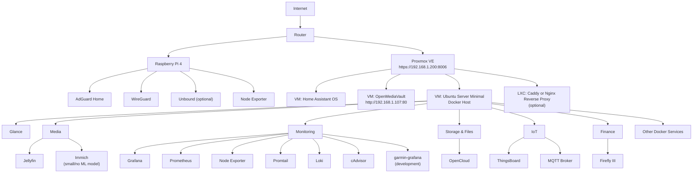
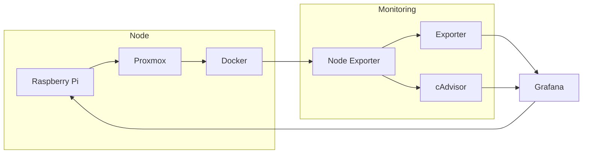

The homelab is split into two distinct roles:

* **Raspberry Pi 4** hosts the core network infrastructure that should remain available even if the Proxmox server is offline or undergoing maintenance.
* **Proxmox VE** hosts applications, media services, monitoring, and IoT workloads using virtual machines and Docker.

This separation improves reliability, simplifies maintenance, and provides a clean foundation for future expansion.



# Proxmox Layout
For a Proxmox homelab setup, keep Home Assistant OS as its own dedicated VM because it is a complete appliance with its own operating system, Supervisor, and update system. Treat it differently from normal applications.

For the rest of your services, avoid creating a VM for every application. A more practical architecture is to create a dedicated Linux server VM as your Docker host and run applications there using Docker Compose. Use a minimal server installation (no desktop environment), with only SSH, Docker, and Docker Compose installed.

Current machine only has 16Gb RAM, so will need some calculation:

| VM                          | Suggested RAM | Idle Usage | Busy Usage | Notes                                                             |
| --------------------------- | ------------: | ---------: | ---------: | ----------------------------------------------------------------- |
| Home Assistant OS           |      **2 GB** |    ~800 MB |   1.5–2 GB | Plenty for a typical smart home.                                  |
| OpenMediaVault              |      **4 GB** |  ~1.2–2 GB |     2–4 GB | Good if using Samba/NFS and software RAID.                        |
| Ubuntu Server (Docker Host) |      **8 GB** |    ~3–4 GB |     6–8 GB | Most Docker apps are lightweight; Immich is the largest consumer. |
| Proxmox Host                |  **1.5–2 GB** |    ~1.2 GB |      ~2 GB | Reserved for the hypervisor itself.                               |

***

# Raspberry Pi 4

The Raspberry Pi serves as the **network infrastructure node**. Services hosted here should continue operating independently of Proxmox.

## AdGuard Home

Provides network-wide DNS filtering and ad blocking.

Keeping DNS on the Raspberry Pi ensures name resolution remains available even while the Proxmox server is rebooting or undergoing maintenance.

## WireGuard

Provides secure remote VPN access to the home network.

Hosting the VPN endpoint outside Proxmox guarantees remote administrative access even if the virtualization host is unavailable.

## Unbound (Optional)

Acts as a local recursive DNS resolver.

Benefits include:

* improved privacy
* reduced reliance on public DNS providers
* local DNS caching

Typical flow:

```
Clients
   │
AdGuard Home
   │
Unbound
   │
Root DNS Servers
```

## Node Exporter

Exports Raspberry Pi system metrics to Prometheus.

Typical metrics include:

* CPU usage
* memory usage
* storage utilization
* network throughput
* CPU temperature

---

# Proxmox VE
Proxmox hosts virtual machines dedicated to applications and services. Virtual Machines and Linux Containers serve different purposes:

A VM is a complete virtual computer. It has its own virtual hardware, operating system, and kernel. It provides stronger isolation and can run different operating systems such as Windows, Linux, BSD, or Home Assistant OS. The trade-off is higher resource usage.

An LXC container is a lightweight Linux environment that shares the Proxmox host kernel. It has its own filesystem, users, and network, but it is much lighter than a VM. LXCs are ideal for simple infrastructure services such as WireGuard, Pi-hole, AdGuard Home, Caddy, or monitoring tools.

For the Docker host, use Ubuntu Server Minimal or Debian. Avoid the full desktop installation because it adds unnecessary packages and services. The goal is a small, stable server dedicated to running containers.

A good deployment order is:

1. Install Proxmox.
2. Create the Home Assistant OS VM.
3. Create the Docker host VM with Ubuntu Server Minimal or Debian.
4. Deploy your applications with Docker Compose.
5. Add monitoring (Prometheus/Grafana) after services are running.
6. Add WireGuard for remote access later.
7. Add a reverse proxy only if you need public domains, HTTPS, or easier access to multiple services.

> Links
> - https://www.home-assistant.io/installation/generic-x86-64/
> - https://pve.proxmox.com/pve-docs/
> - [Proxmox VE Scripts](https://community-scripts.org)


# Monitoring Architecture

Monitoring spans both the Raspberry Pi and the Proxmox environment.



This provides a unified view of:

* Raspberry Pi health
* Proxmox node resources
* virtual machine utilization
* Docker container metrics
* storage usage
* network throughput
* temperatures
* application-specific dashboards

Grafana can correlate metrics across the entire stack, allowing you to drill down from Proxmox host utilization to individual Docker containers.

---

# Design Principles

This architecture follows a few guiding principles:

* **Infrastructure and applications are separated.**
* **Critical network services remain operational during Proxmox maintenance.**
* **Docker is the primary platform for self-hosted applications.**
* **Virtual machines are reserved for operating systems that benefit from isolation (e.g., Home Assistant OS).**
* **Monitoring is centralized through Prometheus and Grafana.**
* **The environment is designed to grow incrementally without requiring major architectural changes.**

## IaC
```
Git Repository
│
├── terraform/
│     ├── proxmox/
│     └── networking/
│
├── ansible/
│     ├── docker-host/
│     ├── omv/
│     └── raspberry/
│
└── docker/
      ├── monitoring/
      ├── media/
      ├── cloud/
      ├── finance/
      └── home/
```

Responsibilities:

| Tool           | Responsibility                                   |
| -------------- | ------------------------------------------------ |
| Terraform      | Create infrastructure (VMs, networks, storage)   |
| Ansible        | Configure operating systems and install software |
| Docker Compose | Run and manage containerized applications        |


This follows a widely adopted separation of concerns.

## Storage convention
| Rule                                                                                       | Example                                                                                                                                               |
| ------------------------------------------------------------------------------------------ | ----------------------------------------------------------------------------------------------------------------------------------------------------- |
| Infrastructure data lives under `.infra/docker/<service>/`                                 | `.infra/docker/immich/`                                                                                                                               |
| User-accessible content lives under `shared/`                                              | `shared/media/photos/`                                                                                                                                |
| Personal files live under `homes/`                                                         | `homes/gabryel/`                                                                                                                                      |
| Services never write directly into `shared/` except for their intended content directories | Jellyfin reads `shared/media`; Immich stores its database under `.infra/docker/immich/` but manages uploaded photos in a designated library location. |
