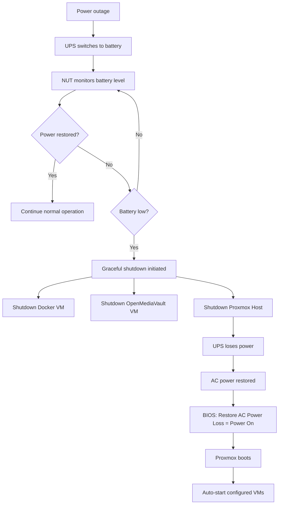

# UPS Management
The standard solution is **Network UPS Tools (NUT)**. Proxmox is just Debian underneath, and NUT is mature, reliable, and widely used.

## Recommended architecture

Since the UPS is physically connected via USB to the Proxmox host, the host should be the UPS "master".

The sequence during a power outage would be:


1. Power fails.
2. UPS switches to battery.
3. NUT detects the event.
4. If power returns before the battery threshold is reached, nothing happens.
5. If the battery reaches a configured level (or runtime), NUT tells Proxmox to shut down.
6. Proxmox gracefully shuts down all VMs.
7. Proxmox powers itself off.
8. When mains power returns, the UPS restores output and, if your BIOS supports **Restore on AC Power Loss**, the server starts automatically.


## First: check compatibility

Not every inexpensive UPS speaks USB HID.

After connecting the USB cable, on the Proxmox host run:

```bash
lsusb
# Bus 001 Device 004: ID 0463:0001 MGE UPS Systems UPS
```

If it's supported you'll usually see something like: `Bus 001 Device 004: UPS HID ...` or a vendor such as:
* Master Power
* Phoenixtec
* Megatec
* HID UPS
* Cypress

Then:

> [!note] If not installed
> ```bash
> apt update
> apt install nut nut-client nut-server -y
> ```

```bash
nut-scanner -U
# Cannot load SNMP library (libnetsnmp.so.40) : file not found. SNMP search disabled.
# Cannot load XML library (libneon.so.27) : file not found. XML search disabled.
# Cannot load IPMI library (libfreeipmi.so.17) : file not found. IPMI search disabled.
# Scanning USB bus.
# [nutdev1]
#         driver = "usbhid-ups"
#         port = "auto"
#         vendorid = "0463"
#         productid = "0001"
#         product = ""
#         serial = ""
#         vendor = ""
#         bus = "001"
#         device = "004"
#         busport = "006"
#         ###NOTMATCHED-YET###bcdDevice = "0110"

# # WARNING: <empty> "serial" reported in some devices: nutdev1
```

## Configure NUT

### 1. `/etc/nut/nut.conf`

```ini
MODE=standalone
```

### 2. `/etc/nut/ups.conf`

```ini
[ups]
driver = usbhid-ups
port = auto
vendorid = 0463
productid = 0001
desc = "Master Power 650VA"
pollinterval = 5
```

---

### 3. `/etc/nut/upsd.users`

Generate a random password:

```bash
openssl rand -base64 24
```

Then:

```ini
[monuser]
password = YOUR_RANDOM_PASSWORD
upsmon primary
```

(`master` still works on many versions, but `primary` is the preferred terminology in recent NUT releases.)

### 4. `/etc/nut/upsmon.conf`

Replace the existing monitor line with:

```ini
MONITOR ups@localhost 1 monuser YOUR_RANDOM_PASSWORD primary

SHUTDOWNCMD "/sbin/shutdown -h now"

POWERDOWNFLAG /etc/killpower

FINALDELAY 10
```

### 5. Enable services

```bash
systemctl enable nut-server nut-monitor
systemctl restart nut-server nut-monitor
```

Check they're healthy:

```bash
systemctl status nut-server
# ● nut-server.service - Network UPS Tools - power devices information server
#      Loaded: loaded (/usr/lib/systemd/system/nut-server.service; enabled; preset: enabled)
#      Active: active (running) since Sun 2026-08-02 11:35:31 WEST; 8s ago
#  Invocation: c56f4cb4e9bf43be8a5bf9c72b07ad03
#     Process: 163553 ExecStartPre=/usr/bin/systemd-tmpfiles --create /usr/lib/tmpfiles.d/nut-common-tmpfiles.conf (code=exited, status=0/SUCCESS)
#    Main PID: 163554 (upsd)
#       Tasks: 1 (limit: 16868)
#      Memory: 780K (peak: 1.8M)
#         CPU: 16ms
#      CGroup: /system.slice/nut-server.service
#              └─163554 /lib/nut/upsd -F

# Aug 02 11:35:31 pve nut-server[163554]: Running as foreground process, not saving a PID file
# Aug 02 11:35:31 pve nut-server[163554]: upsnotify: notify about state 2 with libsystemd: was requested, but not running as a service unit now, will n>
# Aug 02 11:35:31 pve nut-server[163554]: upsnotify: failed to notify about state 2: no notification tech defined, will not spam more about it
# Aug 02 11:35:31 pve nut-server[163554]: upsnotify: logged the systemd watchdog situation once, will not spam more about it
# Aug 02 11:35:31 pve upsd[163554]: Running as foreground process, not saving a PID file
# Aug 02 11:35:31 pve upsd[163554]: upsnotify: notify about state 2 with libsystemd: was requested, but not running as a service unit now, will not spa>
# Aug 02 11:35:31 pve upsd[163554]: upsnotify: failed to notify about state 2: no notification tech defined, will not spam more about it
# Aug 02 11:35:31 pve upsd[163554]: upsnotify: logged the systemd watchdog situation once, will not spam more about it
# Aug 02 11:35:31 pve nut-server[163554]: User monuser@127.0.0.1 logged into UPS [ups]
# Aug 02 11:35:31 pve upsd[163554]: User monuser@127.0.0.1 logged into UPS [ups]

systemctl status nut-monitor
# ● nut-monitor.service - Network UPS Tools - power device monitor and shutdown controller
#      Loaded: loaded (/usr/lib/systemd/system/nut-monitor.service; enabled; preset: enabled)
#      Active: active (running) since Sun 2026-08-02 11:35:31 WEST; 23s ago
#  Invocation: 5bfec82416a140608c66e934c8b5ceef
#     Process: 163556 ExecStartPre=/usr/bin/systemd-tmpfiles --create /usr/lib/tmpfiles.d/nut-common-tmpfiles.conf (code=exited, status=0/SUCCESS)
#    Main PID: 163558 (upsmon)
#       Tasks: 2 (limit: 16868)
#      Memory: 2.7M (peak: 4M)
#         CPU: 22ms
#      CGroup: /system.slice/nut-monitor.service
#              ├─163558 /lib/nut/upsmon -F
#              └─163559 /lib/nut/upsmon -F

# Aug 02 11:35:31 pve nut-monitor[163559]: upsnotify: logged the systemd watchdog situation once, will not spam more about it
# Aug 02 11:35:31 pve nut-monitor[163559]: Poll UPS [ups@localhost] failed - Driver not connected
# Aug 02 11:35:31 pve nut-monitor[163559]: Communications with UPS ups@localhost lost
# Aug 02 11:35:31 pve nut-monitor[163560]: Network UPS Tools upsmon 2.8.1
# Aug 02 11:35:36 pve nut-monitor[163559]: Poll UPS [ups@localhost] failed - Driver not connected
# Aug 02 11:35:36 pve nut-monitor[163559]: UPS ups@localhost is unavailable
# Aug 02 11:35:36 pve nut-monitor[163568]: Network UPS Tools upsmon 2.8.1
# Aug 02 11:35:41 pve nut-monitor[163559]: Poll UPS [ups@localhost] failed - Driver not connected
# Aug 02 11:35:46 pve nut-monitor[163559]: Poll UPS [ups@localhost] failed - Driver not connected
# Aug 02 11:35:51 pve nut-monitor[163559]: Poll UPS [ups@localhost] failed - Driver not connected
```

> [!error] `usbhid-ups` is not running or failed to start
> ```bash
> systemctl status nut-driver
> # Unit nut-driver.service could not be found.
> ```
> On Debian 13 / Proxmox VE 9 (which you're running), NUT 2.8 no longer uses a nut-driver.service unit. The drivers are typically managed through upsdrvctl or spawned by nut-server. To start:
> ```bash
> upsdrvctl start
> ```
> in short: `libusb1: Could not open any HID devices: insufficient permissions on everything`.

```bash
root@pve:~# ls -l /dev/bus/usb/001/004
# crw-rw-r-- 1 root root 189, 3 Aug  2 11:16 /dev/bus/usb/001/004
root@pve:~# id nut
# uid=108(nut) gid=110(nut) groups=110(nut)
```
The nut user isnt in the root group, so it cannot open the HID device for writing.

Running the drive as root:
```bash
/lib/nut/usbhid-ups -DD -u root -a ups
```

exited and to check if the rule still exists:
```bash
root@pve:~# ls /lib/udev/rules.d | grep nut
# 62-nut-usbups.rules
root@pve:~# grep -R "0463" /lib/udev/rules.d
# /lib/udev/rules.d/62-nut-usbups.rules:ATTR{idVendor}=="0463", ATTR{idProduct}=="0001", MODE="664", GROUP="nut"
# /lib/udev/rules.d/62-nut-usbups.rules:ATTR{idVendor}=="0463", ATTR{idProduct}=="ffff", MODE="664", GROUP="nut"
```

#### Reload the rules
```bash
udevadm control --reload-rules
udevadm trigger
```

unpluged the UPS USB cable, wait 5 seconds, and plug it back in. And check:
```bash
lsusb
# ...
# Bus 001 Device 013: ID 0463:0001 MGE UPS Systems UPS
# ...
ls -l /dev/bus/usb/001/013
# crw-rw-r-- 1 root nut 189, 12 Aug  2 11:53 /dev/bus/usb/001/013
```

Restart the NUT services:
```bash
systemctl restart nut-server
systemctl restart nut-monitor
```

And check
```bash
upsc ups
# Init SSL without certificate database
# battery.charge: 100
# battery.charge.low: 10
# battery.runtime: 7200
# battery.type: PbAC
# device.mfr:           
# device.model:                     
# device.serial:                      
# device.type: ups
# driver.debug: 0
# driver.flag.allow_killpower: 0
# driver.name: usbhid-ups
# driver.parameter.pollfreq: 30
# driver.parameter.pollinterval: 5
# driver.parameter.port: auto
# driver.parameter.productid: 0001
# driver.parameter.synchronous: auto
# driver.parameter.vendorid: 0463
# driver.state: updateinfo
# driver.version: 2.8.1
# driver.version.data: MGE HID 1.46
# driver.version.internal: 0.52
# driver.version.usb: libusb-1.0.28 (API: 0x100010a)
# input.frequency: 50.0
# input.voltage: 237.4
# outlet.1.status: on
# output.voltage: 237.3
# ups.firmware:           
# ups.load: 17
# ups.mfr:           
# ups.model:                     
# ups.productid: 0001
# ups.serial:                      
# ups.status: OL
# ups.vendorid: 0463
```

The important values are:

| Parameter         |       Value | Meaning                                         |
| ----------------- | ----------: | ----------------------------------------------- |
| `ups.status`      |      **OL** | On Line (running from mains)                    |
| `battery.charge`  |    **100%** | Fully charged                                   |
| `battery.runtime` |  **7200 s** | About **2 hours** remaining at the current load |
| `ups.load`        |     **17%** | Very lightly loaded                             |
| `input.voltage`   | **237.4 V** | Mains voltage                                   |
| `output.voltage`  | **237.3 V** | UPS output voltage                              |

A 17% load for a 360 W UPS is approximately **60 W**, which is perfectly reasonable for Proxmox host and suggests plenty of runtime.


## Configure Proxmox for graceful shutdown

Since your Proxmox host is the one that receives the UPS event:

1. **Enable the QEMU Guest Agent** for each VM (you've already done this for OMV).
2. Set a reasonable shutdown timeout for each VM (e.g. 120–180 seconds for OMV if it may be flushing writes).
3. Enable **Start at boot** for VMs that should restart automatically.


> [!note]
> At Datacenter > pve > VM > Options > "Start/Shutdown Order"

| VM             | Shutdown timeout |
| -------------- | ---------------: |
| OMV            |        **180 s** |
| Docker Host    |        **120 s** |
| Home Assistant |        **120 s** |

| VM             | Order | Delay | Reason                                                   |
| -------------- | ----: | ----: | -------------------------------------------------------- |
| OMV            | **1** |  10s  | Storage should be available before other services start. |
| Docker Host    | **2** |  30s  | Containers may depend on OMV storage.                    |
| Home Assistant | **3** |  30s  | Can depend on services running in Docker.                |

or via CLI:
```bash
qm config 100
qm set 100 --startup order=1,up=30,down=180
```

## Configure BIOS

Make sure your motherboard is configured to restart automatically when power returns.

Look for a BIOS option such as:

* **Restore on AC Power Loss**
* **After Power Failure**
* **AC Back**
* **Power Loss Recovery**

Mine was Asus so was at `Advanced\APM Configuration`.

Set it to:
```
Power On
```

Then, when utility power returns:

1. UPS restores output.
2. Server powers on automatically.
3. Proxmox starts.
4. VMs marked **Start at boot** are launched.

---

## Monitor the UPS from Grafana (future)

Since you're already building a monitoring stack with Prometheus and Grafana, you can export UPS metrics as well.

A common architecture is:

```text
UPS
 │
 ▼
NUT
 │
 ▼
NUT Exporter
 │
 ▼
Prometheus
 │
 ▼
Grafana
```

That gives you dashboards for:

* Battery charge
* Runtime remaining
* Input/output voltage
* UPS load
* Power outage history
* Battery replacement alerts

It fits naturally into the Prometheus/Grafana stack you already plan to run.

> [!tip] One final recommendation
> I recommend adding a periodic self-test. Many UPSes support it through NUT.
> You can check what commands your UPS exposes:
> ```bash
> upscmd -l ups
> ```
> If it supports a test command, you'll typically see entries like:
> ```text
> test.battery.start.quick
> test.battery.start.deep
> ```
> Running a quick self-test once a month helps catch aging batteries before they fail during a real outage.
